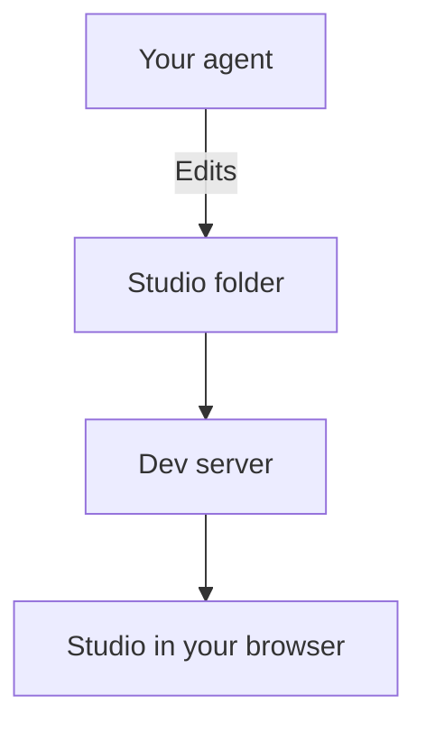

## How do I get started?

If you are reading this in your local studio, it is already running. Otherwise, ask a teammate for access to `endlessm/prototyping-playground` on GitHub, then open your agent in an empty folder and ask:

> Clone endlessm/prototyping-playground, read AGENTS.md, install it with yarn and start the studio. Then register me as a contributor and show me the running studio.

Your agent clones the repository, runs `yarn install` and `yarn dev`, and registers you with `yarn studio join`. The studio needs Node 22 and yarn 4; the agent checks both. The first time you open it, a short welcome explains where to start.

## What needs to be open?

Your **agent** changes files in your **studio folder**. The **dev server** reads those files and serves the **studio in your browser**.

Keep the dev server running while you work. Pages update on their own as the agent saves files: you don't need to reload. Closing a browser tab doesn't lose your work.

Agents start, restart and stop the dev server with `yarn studio dev`, so they never stop another session's server. To open your studio on a phone or tablet on the same network, ask your agent to start it with `yarn dev --host`.

## How do I return later?

Open the same studio folder in your agent and ask:

> Open my Endless Prototyping Playground and show me the running studio.

If the agent can't find it, ask it to look for your existing copy before making another. Your files stay in that folder between sessions. Before you start new work, ask the agent to bring your copy up to date with the team's latest changes.

## How do I join the team?

There is one studio for the Endless team. Each person works in their own copy of its repository and registers once as a contributor, with their name, Git email and GitHub account. Your agent runs `yarn studio join` for you; an Admin can then give you more permissions.

Keep the team's systems, settings and other people's work as they are. See [Working as a team](team.md) for permissions and sharing changes.

## What if I only want to look?

A deployed studio lets you explore prototypes, systems and the Manual without running anything. It is read-only: creating and editing happen in a local copy. See [Publishing & Home](share.md).
