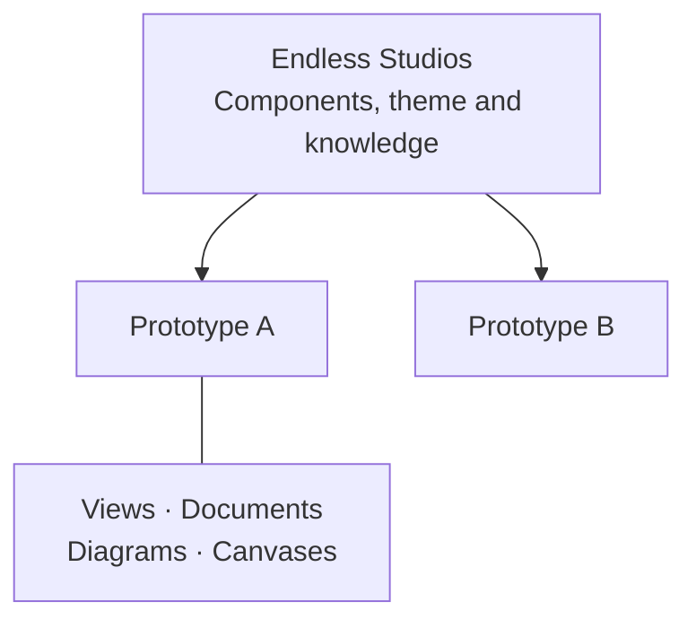

## What is the Endless Design Studio?

The Endless Design Studio is the Endless team's prototyping sandbox. You and your coding agent turn ideas into working prototypes built from Endless Studios' own screens and components, then share them with the team for review.

You direct the work. Your agent builds and refines it. The studio is where you try the result, arrange it beside your thinking, and show it to others.

## How is the studio organized?

There are two collections:

- **Systems** hold a product's foundation: its components, theme, assets and the knowledge agents need to use them. Endless Studios is the team's system.
- **Prototypes** hold individual explorations: working views and the documents, diagrams and canvases that explain them.

Each prototype belongs to one contributor and uses one system. Documents, diagrams and canvases depend on their modules being on.

## What is it made of?

Everything is a plain file in the studio's repository, `endlessm/design-studio`. Views are Vue files that use the system's real components. Documents are Markdown, diagrams are Mermaid and canvases are Excalidraw drawings.

The studio itself is a Nuxt app built with Vue, Nuxt UI and Tailwind, the same stack as Endless Studios. Views render inside their system's own preview, so a prototype looks and behaves like the product, not like the studio around it.

The studio works with coding agents such as Claude Code, Codex and Cursor. It has no agent of its own: keep working in the agent you already use.

## What can it simulate?

This is a front-end prototyping environment. Endless Studios screens run with stand-ins for its backend: sample users, sample data and translations, so a view can show a learner, a mentor or a signed-out visitor without a server. It does not provide a production backend.

## Where should I look next?

| Your question                                           | Chapter                               |
| ------------------------------------------------------- | ------------------------------------- |
| How do I get the studio running, or come back to it?    | [Working environment](environment.md) |
| How do I direct work and show what I mean?              | [Working with your agent](agent.md)   |
| What goes in a prototype, and how do systems fit?       | [Prototypes & systems](prototypes.md) |
| Who can change what, and how do changes reach the team? | [Working as a team](team.md)          |
| How do others see my work, and what does Home show?     | [Publishing & Home](share.md)         |
| How do I change settings or add a capability?           | [Modules & settings](customize.md)    |
| Something is missing or not working.                    | [Help](questions.md)                  |

Search the Manual's chapters by title with **Ctrl+K** (**⌘K** on a Mac). **Documentation → Context & Skills** holds the detailed guidance for the platform and each module, including the instructions your agent follows.
