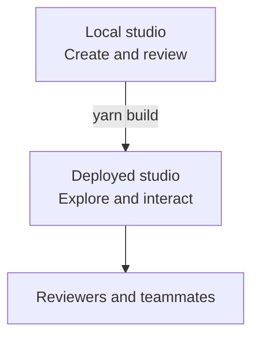

## What is the difference between building and publishing?

Your local studio is where work happens. A deployed studio is a read-only website built from the same files, for people who want to look.

| Local studio                     | Deployed studio                                |
| -------------------------------- | ---------------------------------------------- |
| Create, edit and organize files. | Explore prototypes and interact with views.    |
| See changes as they are saved.   | See changes after the next build.              |
| Work with your agent.            | Read only: no editing, no source, no settings. |

Saving doesn't publish, and neither does merging. Sharing files through Git is a [separate step](team.md#how-do-changes-reach-the-team).

## How do I publish?

`yarn build` makes the deployed studio: a static website in `.output/public` that any static host can serve, at the site's root or under a sub-path. Where the team hosts it is the team's decision, not the studio's. Ask your agent:

> Build the studio for [address] and check the build.

The build stops when something would break the published site, such as a file without its permanent ID or a Manual chapter whose metadata can't be read, and names the file to fix. `yarn preview` serves the build the way a host would, so you can try it before it goes out.

After publishing, open a direct link to a prototype and reload the page. Copy links from the deployed studio, not from your local one: a `localhost` link points at the viewer's own computer.

## What becomes visible?

The deployed studio has active prototypes, active systems with their pages, context and skills, the Manual while it's on, and Context & Skills. Archived prototypes and systems are left out; links to them show a placeholder. Turning a module off leaves its files out of view. Contributors' emails and preferences are never included.

Review sample data, documents and shared guidance before publishing. The studio has no sign-in: anyone with the address can see the site, unless the host restricts it.

## What does Home show?

Select the studio's logo to return to **Home**. It has a search field and blocks from the modules that are on.

Locally, Home greets you and puts your own prototypes first, then recent work from the team and the systems. On the deployed studio it shows the studio's name and tagline and what colleagues come for, without knowing who is looking.

The first time you open Home locally, a short welcome introduces the studio, Endless Studios screens, the canvas and how to ask your agent. Skip it whenever you like; it doesn't open again, even in another browser. To see it again, ask your agent to show you the welcome again.

Something missing from Home may still be in its collection or found through search.

## How do I change Home?

Admins change the studio's name and tagline in **Settings**; they show on the deployed studio after the next build. Home's blocks follow the modules that are on. To change what Home shows beyond that, ask your agent to change the module or add one.

## How do I share with reviewers and engineers?

Share a deployed studio link when people want to explore the experience and give feedback. Links to prototypes, views, states, documents and canvases use permanent IDs, so they keep working after renames and moves. Deleting, archiving or turning off a module can make a link's target unavailable.

Engineers who want the code can pull the repository and open the prototype in its contributor's folder. Views are Vue files that use Endless Studios' own components, so the code reads like the app's. Documents, diagrams and canvases are plain text beside them.

Agree with your engineers on what else a handoff needs.
