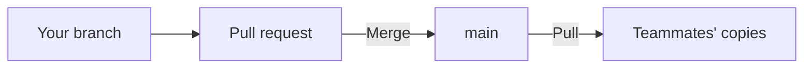

## How does the team share one studio?

The Endless Design Studio is one studio for the whole team. Each person works in their own copy of its repository and shares changes through GitHub. Contributor permissions decide who can change what.

There is no live co-editing: the studio doesn't sync between people while they work.

## Who can change what?

| Role              | Can change                                                                                                              |
| ----------------- | ----------------------------------------------------------------------------------------------------------------------- |
| Contributor       | Their own prototypes.                                                                                                   |
| System maintainer | Their prototypes, plus the context, skills and components of the systems they maintain, while those systems are active. |
| Admin             | Everything: settings, modules, every prototype, systems, the Manual and shared guidance, and who has which role.        |

Maintaining is assigned per system. Open **Contributors** to see who is registered and what each person can do; Admins grant and remove roles there.

Admins can duplicate a colleague's prototype to start from it. Everyone else can read other people's work but not change it. Archived systems must be restored before anyone edits them.

These permissions guide the studio and its checks. They don't sign anyone in, grant GitHub access or control who can see a deployed studio.

## How does a teammate join?

Give them access to `endlessm/design-studio` on GitHub. Their agent clones it and registers them with `yarn studio join`, with their name, the email their Git commits use and their GitHub account. The studio recognises them whenever their Git email matches. See [Working environment](environment.md#how-do-i-join-the-team).

If someone's Git email changes, they add the new one to their profile with `yarn studio profile`, or edit it on their **Contributors** page.

## How do teammates work without getting in each other's way?

Each contributor has a folder of their own for prototypes. The agent finds out who you are and keeps your prototype work inside your folder. Prototypes are separate explorations: changing one never changes another's files.

The studio checks ownership when you save. Checks also refuse a prototype that imports another contributor's code, or code it isn't allowed to reach. Shared systems, modules and the studio itself need a broader review, because everyone's work depends on them.

## How do changes reach the team?

The team protects **main**, the shared branch, and takes changes through pull requests. Your agent can do the Git work:

1. **Work on a branch.** It keeps your changes apart from main while you work.
2. **Open a pull request.** Ask the agent to summarize the changes and run the checks.
3. **Merge when it's ready.** Routine prototype changes can merge as soon as the checks pass. Ask for a review when you want discussion.
4. **Everyone updates.** Teammates pull main into their copies to see the work.

Saving changes only your files. A commit records a version; pushing shares it through GitHub.

## Should prototype work wait until it's finished?

No. Merge small changes to your own prototypes often; merging records progress, not a final design.

| Change                                  | Approach                                                                      |
| --------------------------------------- | ----------------------------------------------------------------------------- |
| Inside your own prototype               | Short branches, merged when the checks pass.                                  |
| A shared system, a module or the studio | Ask the people responsible for a review, and check the prototypes it affects. |

## How do I involve reviewers and engineers?

Share a link for review: see [Publishing & Home](share.md#how-do-i-share-with-reviewers-and-engineers). Engineers can also pull the repository and read a prototype's source and documents directly.
