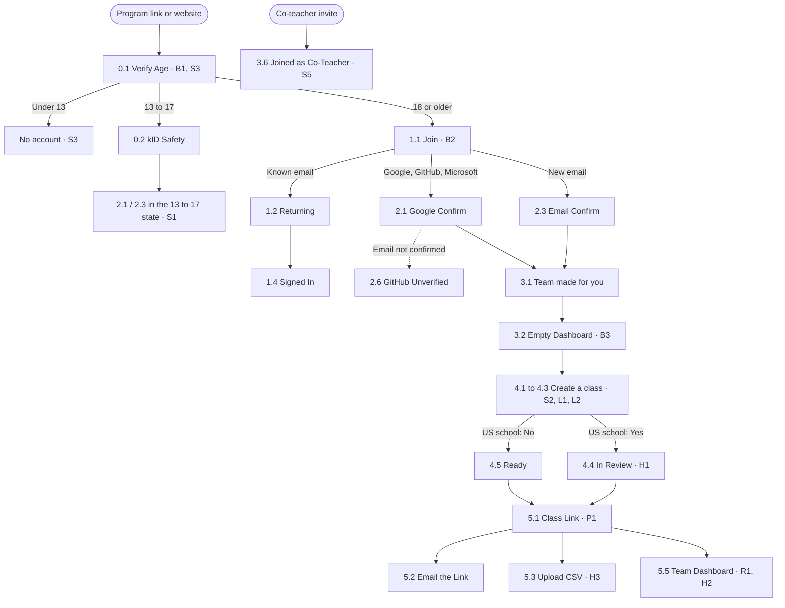

Reviewed 5 November 2026, on the Hi-Fi as of commit `fdfe0e2` ("Refresh the Educator Onboarding prototype").

## Summary

The flow is coherent and well made. One door for new and returning educators, a team made automatically, a class wizard that explains itself and a single class link are the right mechanics. Its error states are the strongest part: they say what happened and what to try, and none of them is a dead end.

Three things need attention before the flow is shown to educators:

1. **Safety.** Two blockers. A 13 to 17 year old can sign up as "Parent or Guardian", and the "US school?" question gives every school outside the US an open class by default. Safe before anything wins every conflict, so these come first.
2. **Who the flow is for.** It is drawn around a homeschool co-op lead, which matches Beth, a *hypothesized* persona. Daniel, the only *evidence-based* educator, has his top job unmet: seeing one lesson and the device, age and credential facts before he creates an account.
3. **Words and signals.** Class, cohort, team and space name overlapping things, and the status colours on the Team Dashboard draw the eye to the rows that need nothing.

| Principle | Verdict | In one line |
| --- | --- | --- |
| 1. Everyone belongs | Partly | Welcoming once inside; the first screen and the vocabulary speak to a learner. |
| 2. Learning is not linear | Partly | Many doors (program link, invite, returning), but nothing to judge before an account, and the wizard can lose work. |
| 3. Play matters | Partly | Little is scary to press, except Reset Link. Nothing invites the educator to try a workshop. |
| 4. Share often. Be open. | Errors strong, people missing | Model error states; no way to reach a person anywhere. |
| 5. Reflect and refine | Mostly | Clear stage ends (4.5, 5.5); status colours point at the wrong rows. |
| 6. Create for impact | Not addressed | Acceptable for onboarding, but the program choice hides the credential and the audience. |
| 7. Safe before anything | Needs work | Teal, Terms and class-link guards are right; two blockers in roles and class type. |

**Severity.** *Blocker*: fix before any session with educators or learners. *Major*: decides whether the flow works for a persona. *Minor*: copy, polish or a smaller gap.

## How this was reviewed

- **Scope.** The 26 Hi-Fi views and their 6 named states, rendered in the Endless Studios preview, plus the code behind them and the Lo-Fi notes. The numbered markers and dashed routing boxes were read as designer notes, not as interface.
- **Measured against** [Design Principles](/systems/8x5spen6xtvp96a9/context/design-principles) (the review questions of each principle), the decision tests in [Personas](/systems/8x5spen6xtvp96a9/context/personas), and Safeguarding and the shared jobs in [User Types](/systems/8x5spen6xtvp96a9/context/user-types).
- **Evidence.** No user saw these screens. Daniel's card is evidence-based; Rania, Chris and Omar are partial; Beth and Andrés are hypothesized. Findings that rest on a partial or hypothesized card are marked *assumption*.

## The flow and where the findings sit

## What works, and should stay

- **One door** ([1.1 Join](<./Hi-Fi/1 Join and Log In/1.1 Join.vue>)). The email decides whether the page logs in or signs up, so nobody answers "log in or sign up?" wrongly. Single sign-on gets the same treatment. Many entry points, one path (principle 2).
- **Errors that never strand anyone** (principle 4). [2.6 GitHub Unverified](<./Hi-Fi/2 Sign Up/2.6 GitHub Unverified.vue>) is the model: it names the problem, lists the steps, offers email instead, and says why it asks. Terms not ticked (2.2), nothing chosen in the wizard (4.2) and the CSV's rows to fix, with "Add the 4 Ready", follow it.
- **Consent is never a default** (principle 7). The Terms are a box the educator ticks; the class link has seats, an expiry and "Approve each learner" on by default; an NDPA class gets no open link.
- **Teal only where it belongs.** [0.2 kID Safety](<./Hi-Fi/0 Verify Age/0.2 kID Safety.vue>) is the one teal surface, as the theme reserves it.
- **No step where none is needed.** The team is made automatically and renamed later, from a banner that never blocks (principles 2 and 3).
- **Momentum during review.** [4.4 In Review](<./Hi-Fi/4 Create Cohort/4.4 In Review.vue>) lets the educator add learners while Endless reviews (principles 2 and 5).
- **Clear ends.** "Spring Game Makers is ready" (4.5) closes a stage, and the Team Dashboard's seats bar and per-learner status show where things stand (principle 5).
- **System craft.** Figtree and Inter, orange primary with dark text on every screen, one primary action per screen, hairline borders before shadows, a spinner that honours reduced motion, and sample quotes labelled as samples.

## 7. Safe before anything

First, because it wins every conflict. Review question: *who can see this, and did someone with the right to decide say yes?*

### S1 · Blocker · A 13 to 17 year old can join as "Parent or Guardian"

In the 13 to 17 state of 2.1 and 2.3, only Educator is disabled in **Joining as**; Parent or Guardian stays selectable. Whatever that role can do, it exists for the adult side of consent, and a 15-year-old must not be able to claim it.

**Change:** for 13 to 17, show Joining as as a fact ("Learner") rather than a select, with one line on why.

### S2 · Blocker · "Is this class part of a US school?" sends non-US schools to an open class

The question asks about legal jurisdiction when the decision is about visibility. It defaults to No, and No means an open class whose learners can share in the Endless gallery. A school teacher in Jordan, the UAE, Saudi Arabia or Mexico (the mandate-driven type) answers No truthfully and gets an open class; so does a US teacher who skims. Lina's decision test asks that she "should be seen only by her class". *Assumption*: Rania and Lina are partial cards.

**Change:** ask what the class is (a school, a homeschool group, co-op or club, a partner program) with no answer chosen, and derive the rules from the answer and the country. Until rules for non-US schools exist, any school should get the closed class and the review, not the open one.

### S3 · Major · The under-13 answer invites a second try, and ends there

The Lo-Fi note says the date stays filled in "so a mistyped year is fixed in place". For a 12-year-old that is also an invitation to type an older year. Principle 3 (undo is always there) and principle 7 conflict here, and principle 7 wins. The message also ends the path with no next step (principle 4).

**Change:** decide with whoever owns the kID integration how the gate behaves after an under-13 answer. A neutral age screen usually does not invite a retry. Give a next step that creates nothing, such as what a parent or teacher can do.

### S4 · Major · The open class doesn't say who can see or contact learners

Where you teach and Review say "Learners can share their games in the Endless gallery". It reads as public by default. Beth, Chris and Andrés all ask first who can reach the kids, and Safeguarding says consent fires when work leaves the cohort, which the copy never mentions.

**Change:** one line in both places, for example "Under-18s share only after a parent says yes. Nobody outside the class can message them", once the team confirms that is the rule.

### S5 · Major · One email gives a co-teacher every learner

Team Settings (3.5): "Co-teachers can create cohorts and see all of this team's learners." There is no confirmation, no scope and nothing the co-teacher agrees to. Andrés' card says background checks and who can contact the kids "have to be settled before he gets any tool that reaches them". *Assumption*: Andrés is hypothesized, but the rule is safeguarding, not preference.

**Change:** a product decision: what a co-teacher sees by default (one cohort or all), whether the owner confirms they know the person, and the code of conduct shown to the co-teacher on joining.

### S6 · Minor · No code of conduct where people meet

Principle 7 asks for a code of conduct everywhere people meet, and a class is where learners meet. Neither creating an open class nor the class link page shows one.

**Change:** the educator accepts the community guidelines when creating an open class; the join page (outside this prototype) shows them to learners.

### S7 · Minor · Review names Threadbare whatever program was chosen

For a school class, the Review step always lists "Explore: Threadbare, the only program reviewed for school use", even when Godot was chosen, and the wizard lets that through.

**Change:** with Yes, offer only programs reviewed for school use, or say on the Program step why the choice must change.

## 1. Everyone belongs

Review question: *who in the room would feel this is not for them?*

### B1 · Major · The educator's first screen is an age check written for a learner

0.1 opens with a cake and "We need to verify your age. We verify your age to ensure you receive appropriate content…". It repeats itself and speaks to a child. For a teacher who followed a program link, it is the first impression, and the program they came for is gone (see L1).

**Change:** keep the gate, write it for everyone: "Endless is for makers 13 and up. What's your date of birth?", and name the program they followed.

### B2 · Minor · Three names on one page

Join reads "Join Endless Access" under the Endless Studios logo, beside "build their first games on Endless". User Types already records Endless and Endstar confusion.

**Change:** one product name on the account pages, chosen with whoever owns the brand.

### B3 · Major · Class, cohort, team and space

| Word | Where it appears |
| --- | --- |
| Cohort | Empty state ("No cohorts yet", "Create Your First Cohort"), sidebar, cohort table, the Create Cohort button |
| Class | Wizard ("Create a class", "Class name", "Create Class"), Class Link, Class Code, "Open Class" badge |
| Team | "We made a team for you", Team Dashboard, Team Settings |
| Space | "Setting up your space…" (3.1) |

The empty state has to define its own word: "A cohort is one class". Educators say class, and the wizard already does.

**Change:** "class" wherever an educator reads it, cohort as the internal term only. Drop "space".

### B4 · Minor · The app around the flow still speaks to a learner

Beside Teach, the sidebar shows Play and Learning, with My Programs. User Types records "My Programs" among the signs that "the platform speaks to a learner, not a teacher".

**Change:** for an educator account, lead with Teach and move the learner groups below it or behind a switch.

### B5 · Minor · Nothing tells a non-coder this is for them

Daniel's messaging is "Not a CS teacher? Start here"; Beth's is "You don't need to code to guide this". The brand panel beside every account page says "Make games. Learn together."

**Change:** use that panel for the reassurance: "You don't need to code to teach this."

## 2. Learning is not linear

Review question: *can someone start here without having done what comes before? What happens if they leave halfway?*

### L1 · Major · Daniel can't judge the program before he has an account

Daniel's first job is to see one lesson and the facts on devices, age and credentials before creating an account. All five usability participants stopped at sign-up to ask for it. In this flow, the first look at a program (workshops, skills, the teacher guide) comes in the wizard, after three account pages and the dashboard. Program details have no device or credential facts at all.

User Types records this as a conflict: the educator wants to see a lesson before an account exists; the team wants the account to measure impact. It is a product decision, not a copy fix.

**Change:** decide whether the program details and the teacher guide preview are public at the program link. Either way, carry the program through sign-up ("You're setting up Explore: Threadbare") so the link isn't lost for three pages, and add a "Runs on" line (Chromebooks, phones) and the credential to Program details.

### L2 · Major · Closing the wizard throws the class away

Escape and × close the wizard with no confirmation and no draft, even on the Review step with three answers given. Clicking outside the CSV modal after a file is read does the same. Principle 2: work stops without loss and resumes where it left off.

**Change:** keep a draft and reopen at the same step, or confirm when answers would be lost.

### L3 · Minor · Four steps when every default is right

Acknowledged in the Lo-Fi notes. From a program link, the default path is Continue three times, then Create Class.

**Change:** test a "Create with these details" shortcut to Review when arriving from a link, before merging steps.

### L4 · Minor · Under-13 classes have no path

Two of the five usability participants teach 10 to 12 year olds, and Chris has under-13s in the room. The flow is silent beyond "Ages 13+". Not a fix for this prototype; it belongs on the open questions.

## 3. Play matters

Review question: *what is the worst thing that happens if they press the wrong button?*

### P1 · Major · Reset Link has no safety net

On 5.1, Reset Link sits beside Show QR as a quiet button. Pressing it breaks the link already pasted in the co-op's group chat, for every family, with nothing to undo it.

**Change:** confirm with the consequence ("The link in your group chat will stop working"), or offer undo.

### P2 · Minor · Let the educator play Workshop 1 first

Daniel never wants to improvise in front of 30 teenagers; Beth learns a few weeks ahead of her kids. The flow ends at "Open Workshop 1" for the class, and never invites the educator to try it alone.

**Change:** a "Try it yourself" entry on 4.5 and the Team Dashboard, beside "Preview the teacher guide". It invites play before instruction.

## 4. Share often. Be open.

Review question: *where does this flow leave someone stuck with no way out?*

### H1 · Major · No way to reach a person anywhere

Across 26 screens there is no help, contact or peer link, apart from "Learn more" on kID Safety. The moments that need one most: In Review (how long, and who to ask?), GitHub Unverified, and the Team Dashboard's "Needs parent consent" and "Bounced". "People keep people" is raised by seven of the eight types.

**Change:** a help entry in the app's top bar, and on In Review an expected review time and a contact.

### H2 · Major · "Needs parent consent" is a status with nothing to do

The Team Dashboard shows it without saying who was asked, when, or what the educator can do. Marcus's bounced email gets a line with Fix Email; Priya gets nothing.

**Change:** "Waiting for a parent since Mar 1 · Remind", or say that her parent got an email and the educator can't approve it for them.

### H3 · Minor · Learners without an email can't receive an invitation

The CSV's email column is optional, yet the modal says "Each learner gets their own invitation to finish signing up". Tobi has no email and shows as Joined.

**Change:** say what happens to a learner without an email (the educator gives them the class code).

### H4 · Minor · Sample quotes read as real

The context column's quotes are labelled "sample quote", which is right for the team. A test participant reading "Middle school teacher" will take them as real. Personas: never quote a placeholder as something a user said.

**Change:** replace them with real quotes or hide them before testing.

## 5. Reflect and refine

Review question: *how does the educator know a stage is done?*

### R1 · Major · Status colours point at the wrong rows

On the Team Dashboard, Joined, the state that needs nothing, uses the orange tint that `Badge.vue` reserves for "a state that needs attention". Needs parent consent, which does need attention, is neutral grey, and Bounced, an error, is cornflower, the tone the component gives a role. The eye lands on the three rows that are fine.

**Change:** Joined in the soft success colour (lime 50 with 700 text) or neutral, Needs parent consent in soft warning (amber 50 with 800), Bounced in soft error (red 50 with 700), as the theme's soft pattern asks.

### R2 · Minor · No sense of "set up and ready to teach"

Account, class, learners and the first workshop are four stages. 4.5 closes one; the Team Dashboard never says the class is ready to start or that two learners are still missing.

**Change:** a short setup checklist on the Team Dashboard until Workshop 1 opens.

## 6. Create for impact

Review question: *who outside Endless will see or play this?*

### I1 · Minor · The credential and the audience are missing from the program choice

Daniel's social job is a credential for college applications and work he can show the school; Beth needs proof of hours. Program details show skills and workshops, not what learners leave with or who will play their games.

**Change:** a "What learners leave with" line: the credential, stated plainly and only if it exists (User Types records "coming soon" as a pain point), and for an open class, that families can play the games.

## Interface quality

Craft and system checks outside the principles.

- **V1 · Major (for testing) · Notes look like interface.** Numbered markers and dashed routing boxes are drawn inside the screens, and only some views can hide them (`walkthrough`); 0.1, 1.1, 1.4, 2.1, 3.1, 3.6 and 4.5 always show them. They share the cornflower tint with real panels (the Google hint, the team banner, the NDPA explanation). A participant will read them as interface. Add one switch that hides every note for test sessions.
- **V2 · Minor · Errors in an info panel.** Upload CSV's "Rows to fix" are red text on the cornflower info panel. Use the soft error colour for the panel.
- **V3 · Minor · Wizard layout.** The 190px program list breaks "Explore: Threadbare" and "Ages 13+" over two lines; the context column leaves a tall gap with the quote pinned to the bottom. Widen the list or put its details on one line, and keep the quote under the context text.
- **V4 · Minor · Mixed capitalization.** Title Case ("Bring Your Learners In", "Send the Link by Email", "Create Your First Cohort") sits beside sentence case ("Create a class", "Rename team", "Review your class"). The app mixes them too; pick one rule for this flow and record it.
- **V5 · Minor · Copy.** "Max Number Of Users" is the app's internal field name; "To guarantee your safety…" promises more than any product can ("To help keep you safe"); "Before we begin…" and the repeated sentence under it (B1).
- **V6 · Minor · Accessibility.** The No / Yes switch on Where you teach isn't announced as a choice: the selected option is plain text and the other a button, so a screen reader can't tell which is chosen. Use a radio group.
- **V7 · Minor · Password effort.** Sign-up asks for four rules and a Repeat Password; log-in already has Show password. A show toggle on sign-up replaces the second field.

## Persona decision tests

| Persona | Confidence | Result | What decides it |
| --- | --- | --- | --- |
| Daniel | Evidence-based | Fails | Can't judge without an account (L1); no device facts; the NDPA review exists, but no paperwork to show the district. |
| Beth | Hypothesized | Mostly passes | The flow is drawn for her: co-op, "choose No", a team made for her. Fails "who can reach her kids" (S4); hours not addressed. |
| Rania | Partial | Fails (*assumption*) | A non-US school gets an open class (S2); English and Español only. |
| Chris | Partial | Partly | The co-teacher path fits (3.6); under-13s and phones not addressed. |
| Omar | Partial | Partly | Team switcher, CSV and co-teachers help; classes are made one wizard at a time and school classes wait on Endless. |
| Andrés | Hypothesized | Unclear | Shared computers not addressed; co-teacher access unscoped (S5). |

**A naming clash.** The sample educator is Maya Okafor, a homeschool co-op lead. In Personas, Maya is the 15-year-old learner by choice, so anyone reading the notes beside the personas pictures the wrong person. The co-op setting is Beth's, a hypothesized card. Rename the sample educator, and label the flow as resting on an assumption until an independent educator has been interviewed. The Lo-Fi notes' "Type 8 educators" also doesn't match User Types, where the eighth type is the reporting partner; independent non-formal educators are the seventh.

## What to do next

1. Fix **S1** and **S2** before any session with educators.
2. Decide with the team: the under-13 gate (**S3**), preview before sign-up (**L1**) and co-teacher access (**S5**).
3. Cheap and high-value: one word for class (**B3**), status colours (**R1**), Reset Link confirmation (**P1**), the safety line on open classes (**S4**).
4. Add a way to reach a person and a review time (**H1**, **H2**).
5. Prepare for testing: a switch that hides the notes (**V1**), real or no quotes (**H4**), a renamed sample educator.
6. Test with a teacher like Daniel first, the evidence-based card, then with a homeschool parent to validate Beth.

## Open questions for the team

- Who owns the age gate's behaviour after an under-13 answer, and what does kID require?
- What can a Parent or Guardian account do today?
- What are the rules for school classes outside the US?
- Can a program's details and teacher guide be public, before an account?
- What does a co-teacher see, and what do they agree to?
- Is there a path for classes of 10 to 12 year olds, now or planned?
