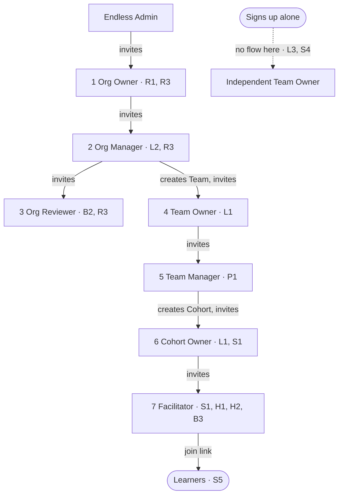

Reviewed 18 November 2026, on the Hi-Fi flows as they stand in the working tree (not committed yet). The role model is Proposed and nothing here is built.

## Start here

Five changes come before everything else:

1. **Add a safety step before anyone reaches learners.** A Facilitator invited at any email address sees learners' full names and emails with nothing agreed first (**S1**, the only blocker).
2. **Give the teacher who does it all a short path.** Six accepted invites stand between Endless and the first learner, and no screen offers the shortcut the model allows (**L1**).
3. **Make each role's first task its real first job.** Two roles start with the wrong one (**L2**).
4. **Put a person to ask on every welcome.** No screen in the seven flows offers one (**H1**).
5. **Make the context agree with itself.** The role model in the system context still has nine roles; this prototype has seven (**C1** to **C5**).

| Principle | Verdict | In one line |
| --- | --- | --- |
| 1. Everyone belongs | Partly | One pattern for every role and plain "you can" lists; English only, and written for a district nobody has described. |
| 2. Learning is not linear | Needs work | A strict chain of invites; the person who teaches alone and the one who started alone have no path. |
| 3. Play matters | Partly | Little is scary to press, except Remove and Archive, which have no way back. |
| 4. Share often. Be open. | People missing | The expired invite is a model error state; nobody to ask, and a Facilitator can't see who else runs the Cohort. |
| 5. Reflect and refine | Partly | "Added by" and Invited are there; nobody sees the chain move, and the two top roles have no reports. |
| 6. Create for impact | Not addressed | Acceptable for onboarding; Programs are names without the facts a district decides on. |
| 7. Safe before anything | Needs work | Scopes are right (Facilitator sees one Cohort, Reviewer sees no names); who gets in is not. |

**Severity.** *Blocker*: fix before any session with educators or learners. *Major*: decides whether the flow works for a persona. *Minor*: copy, polish or a smaller gap.

Findings: 1 blocker, 16 major, 13 minor, plus 5 context corrections.

## How this was reviewed

- **Scope.** The 36 Hi-Fi views and their 14 named states (Signed In and Expired on every Accept), read in the code of the views and the shared kit; six screens rendered to confirm what is on them. The sample world and the walkthrough notes were read as the designer's intent.
- **Measured against** [Design Principles](/systems/8x5spen6xtvp96a9/context/design-principles), the decision tests in [Personas](/systems/8x5spen6xtvp96a9/context/personas), the jobs to be done in [User Types](/systems/8x5spen6xtvp96a9/context/user-types) and the model in [Educator Roles](/systems/8x5spen6xtvp96a9/context/educator-roles).
- **Evidence.** No user saw these screens. Daniel's card is evidence-based; Rania, Chris, Omar and Carmen are partial; Beth and Andrés are hypothesized. A finding that rests on a partial or hypothesized card is marked *assumption*.

## The chain and where the findings sit

## Part 1 · Roles against user types and personas

### Who holds which role

| Role | In the sample world | Nearest user type | Persona | Fit |
| --- | --- | --- | --- | --- |
| Org Owner | Grace | Reporting partner or buyer, as the person who signs | Carmen, only as signer | **Gap.** Nobody describes the person who administers an Organization. |
| Org Manager | Marcus | Partner facilitator or program leader | Omar | Good. *Assumption.* |
| Org Reviewer | Linda | Reporting partner or buyer; a mandate teacher's supervisor | Carmen | Right scope, wrong format. |
| Team Owner | Aisha | Autonomous educator whose district joined; program leader at one site | Daniel, Omar | Partly: the flow has her delegating. |
| Team Manager | Ben | Partner facilitator or program leader | Omar | Good. *Assumption.* |
| Cohort Owner | Sofia | Mandate-driven educator; a co-teacher | Rania | Partly: she teaches, the flow has her staffing. |
| Facilitator | Sam | Partner facilitator or program leader | Chris; Andrés when he volunteers | Right role, jobs unmet. |
| Team Owner of an Independent Team | Sam's Weekend Game Lab | Independent non-formal educator; an autonomous educator who signs up alone | Beth, Andrés, Daniel | No flow here; Educator Onboarding covers it. |
| Learner | Jaylen and four more | The three learner types | Maya, Lina, Diego | Out of scope; touched by the join link. |

### What agrees

- **Every persona has a role to hold.** None needs a role the model lacks.
- **The model splits Chris and Omar the way the personas do.** The one in the room is a Facilitator; the one who sets up is a Team Manager or Org Manager. User Types still lists them as one type and asks for the split in its own decisions table.
- **One account, several roles** matches the independent educator, who "arrives wanting to learn first, then becomes a mentor": Sofia learns in Sam's Cohort and owns her own.
- **Aggregated reports for the Org Reviewer** match Carmen's job word for word ("with no named learners"). That is evidence for closing the model's open question on Reviewer scope.
- **A Facilitator who sees only their Cohort** fits Chris, who runs a group he didn't recruit.

### What doesn't agree

**M1 · Major · Nobody describes the person who administers an Organization.** Flows 1 and 2, twelve of the 36 views, are drawn for a district administrator. No user type or persona covers that person. The nearest traces are in User Types under "Emerged": the district coordinator who evaluates, the delivery partner that runs cohorts itself, and Daniel's "district privacy person". *Change:* add an Organization administrator to User Types, or split the partner type as that document already recommends (delivery partner lead for Org Owner and Org Manager, system buyer for Org Reviewer). Until then, label flows 1 and 2 as assumptions.

**M2 · Major · The sample world is the case with the least evidence.** Brightwater is a US district that adopts top down. The evidence-based US educator, Daniel, arrives bottom up: he finds the program himself and then fights for district approval. The documented top-down cases are a delivery partner in Jordan (Omar, Rania; Arabic) and a university in Peru (Carmen; Spanish). *Change:* add a second sample world, a delivery partner with Omar as Org Manager, Rania as Cohort Owner and instructors like Chris, and run the seven flows against it.

**M3 · Major · The evidence-based educator has no invited flow.** Daniel signs up alone, so he gets an Independent Team. See **L3** for what happens when his district joins later.

**M4 · Minor · Role names aren't the words people use for themselves.** The personas say teacher, program leader, mentor and parent; only Facilitator matches. Three of the seven roles are an Owner. *Change:* keep the names, and lead each invite with the job ("Sofia asked you to run the sessions of Spring Game Makers"), with the role as a label. Test "Org Reviewer" with a partner lead: it can read as someone who approves.

**M5 · Minor · An independent educator needs a Team and a Cohort to teach two children.** Beth has two learners; Andrés has thirteen. *Assumption*, both cards are hypothesized. Worth asking in the homeschool conversations the validation plan already lists.

### Context that disagrees with itself

| | Where | What disagrees | Change |
| --- | --- | --- | --- |
| **C1** | Educator Roles | Describes nine roles (11 November). This prototype follows the seven agreed on 12 November. An agent reading the context builds the old model. | Rewrite it for seven roles; keep the nine as history. |
| **C2** | Platform Model | Says the Educator Onboarding "co-teacher" is a Team Manager. In v2 a co-teacher is a Cohort Owner. | Correct the sentence. |
| **C3** | Personas, User Types | Personas cites User Types version 1.2 (26 October); the context holds version 1.1 (21 October). | Bring in 1.2 or correct the citation. |
| **C4** | User Types | One type for "facilitator or program leader"; Personas has two cards. The summary table and the headings name types differently ("Autonomous educator", "Autonomous classroom educator"). | Split the type; use one name each. |
| **C5** | The two prototypes | Educator Onboarding says class and co-teacher; Role Onboarding says Cohort and Cohort Owner. | Choose one vocabulary before either is tested. |

## Part 2 · Each role's onboarding against its jobs

Every flow has the same four beats: the invite, accepting it, a welcome on the place, and the first task.

| Flow | Stands for | Their top jobs | What the flow gets right | What it misses |
| --- | --- | --- | --- | --- |
| 1 Org Owner | Carmen as signer; an administrator nobody described | Every student in the right class with nothing to configure. A program that runs without Endless staff. Residency, ownership and consent answered. | Delegating is step one. The invite names the person at Endless. | No view of the set-up moving (**R1**), no reports (**R3**), no trace of the agreement (**S6**). |
| 2 Org Manager | Omar | Set up cohorts and rosters myself. Staff them. See who is progressing. | Creates a Team and names its owner in one modal, without Endless. | Reviewers before Teams (**L2**), one person at a time, no numbers across Teams (**R3**). |
| 3 Org Reviewer | Carmen; Rania's supervisor | Results in my framework, before the end, with no named learners. Stories I can share. | No names anywhere, a View only badge, numbers while Cohorts run. | Endless' words, no drop-off, no export (**R3**); a learner's app around it (**B2**). |
| 4 Team Owner | Daniel once his district joins; Omar at one site | Ready-to-teach units and a pacing guide. Peers who have taught this. | Lands on her own Team and may create the Cohort herself. | Pushed to delegate first (**L1**); the Team page never shows the Programs (**I1**). |
| 5 Team Manager | Omar | Set up cohorts myself and see who is progressing. | A short Create a Cohort; sees every Cohort in the Team. | Can't name who runs the Cohort while creating it (**L1**); can archive a colleague's Cohort with no way back (**P1**). |
| 6 Cohort Owner | Rania; a co-teacher | Deliver every lesson as designed. Show the supervisor it works. | Runs one Cohort without the rest of the Team in the way. | The first step is staffing, not her class (**L1**); invites any email with nothing agreed (**S1**); can't run the Cohort again next term. |
| 7 Facilitator | Chris; Andrés as a volunteer | Run the hour alone with little prep. Someone to call. A real answer for a parent. | Sees only this Cohort; one link for the whole class. | Nobody to ask (**H1**, **H2**), roster before session (**L2**), learners' details (**S1**), no dates in the invite (**B3**). |

### Persona decision tests

| Persona | Confidence | Result | Why |
| --- | --- | --- | --- |
| Daniel | Evidence-based | Not covered | He arrives alone, outside these flows, and can't bring his Team in later (**L3**). |
| Rania | Partial | Fails | English only, nothing in the authority's vocabulary (**B1**, **R3**). |
| Chris | Partial | Partly | Scope and join link are right; no one to call, no dates, no rule for under-13s. |
| Omar | Partial | Mostly | Creates and staffs without Endless; one at a time, and can't see who is stuck. |
| Carmen | Partial | Partly | No named learners and numbers before the end; not her vocabulary, nothing to take to a board. |
| Beth | Hypothesized | Not covered | The Independent path lives in Educator Onboarding. |
| Andrés | Hypothesized | Partly | Any email can be invited; what protects the kids isn't settled (**S1**, **S4**). |

## Part 3 · Findings by principle

### 7. Safe before anything

*Who can see this, and did someone with the right to decide say yes?*

**S1 · Blocker · An outside Facilitator sees learners' names and emails, with nothing agreed first.** A Cohort Owner invites any email address ([6.4](<./Hi-Fi/Pages/6 Cohort Owner/6.4 Invite Facilitators.vue>)). The only check on the way in is a self-declared age of 18 or older. The Facilitator then sees each learner's full name and school email, removes learners and grants certificates. Today's app shows only the first name of a 13 to 17 year old. User Types names background checks as standard for mentors and notes that under-18 volunteers are common in clubs like these (desk research). *Change:* accepting a role that reaches learners includes a safeguarding agreement and the code of conduct; an address outside the Organization's domain needs a second yes from the Organization; the learner list follows the app's rule for under-18 learners.

**S2 · Major · The district can't see who reaches its learners.** The Organization's People tab lists Org roles only. The question Daniel's district asks first, and the one a parent asks Chris, is who can contact students. *Change:* make the Org Chart exploration the Organization's People tab, with a filter for people from outside the district.

**S3 · Major · An invite isn't tied to the person it was sent to.** The email field on Accept can be edited, and the Signed In state assumes the account already matches. A forwarded invite to a role with learners is the risk; a teacher with a school account and a personal one is the everyday case. *Change:* lock the invited address, and draw the state for "signed in with a different email".

**S4 · Major · An Independent Team takes under-18 learners with no gate.** Sam's Weekend Game Lab has six learners and no institution behind it, and only an Endless Admin can remove its owner. Andrés' card says this has to be settled before he gets any tool that reaches kids. *Assumption.* *Change:* a team decision; one option is consent at join for every Independent Cohort, as Endless-run open cohorts already require.

**S5 · Minor · Who's in says nothing about consent.** A Facilitator can't tell which learners may publish. *Change:* show the status only where it blocks something, with the action beside it.

**S6 · Minor · The agreement behind the Organization is nowhere in it.** Settings holds a name. Approval is a core job for every adult type. *Change:* show the signed agreement, the data terms and the Endless contact, read only.

### 1. Everyone belongs

*Who would feel this is not for them?*

**B1 · Major · English only, by email only.** The Accept page draws "English · Español"; the invite email and the app don't, and Arabic appears nowhere. Four of the seven educator and partner personas work in Spanish or Arabic. *Assumption* for the effect; the screens are a fact. *Change:* the Organization sets its language, invites go out in it, and Invite and Accept get an `es` state.

**B2 · Minor · A superintendent gets a learner's app.** The Org Reviewer's sidebar offers Play, My Projects and My Programs, and reading four numbers takes an account. Carmen "reads reports, not the platform". *Change:* a reduced frame for a Reviewer, and the report by email (**R3**).

**B3 · Major · A volunteer's invite doesn't say when or how much.** [7.1](<./Hi-Fi/Pages/7 Facilitator/7.1 Invite.vue>) names the role, the Cohort and the district, but not the start date, the ten weekly sessions or the Program. Andrés can give a few hours a month; Chris walks in with little prep. *Assumption.* *Change:* invites to Cohort roles carry the Program, the dates and the number of sessions.

### 2. Learning is not linear

*Can someone start here without having done what comes before?*

**L1 · Major · The teacher who does it all has no path.** The model lets a higher role act as the ones below, so one person can create a Team, a Cohort and bring in learners. No welcome offers it. The Team Owner's first step is "Add Team Managers". The card on a Cohort you just created offers "Add another Cohort Owner" and "Invite the Facilitators", and never the learners. Daniel, Rania and Beth are all the person in the room. *Change:* the welcome asks once, "I'll teach it myself" or "Others will teach", and the first choice leads to a Cohort, its learners and Session 1.

**L2 · Major · Two roles start with the wrong task.** The Org Manager's first step is adding Org Reviewers before any Team exists, so Linda accepts and lands on an empty report. The Facilitator's first step is the roster, though for Chris someone else set it up; "Look over Session 1" is step two and has no screen. *Change:* the Org Manager creates a Team first, and a Reviewer is invited once there is something to read; a Facilitator whose Cohort already has learners starts on Session 1.

**L3 · Major · An educator who started alone can't bring their Team into the Organization.** The model says existing Independent Teams stay Independent. Daniel's order of events is exactly that: he starts alone and the district comes later. His Cohorts and learners would stay outside the district's reports and its data terms. *Change:* decide whether an Org Manager can invite a Team in, and what happens to its learners' data.

**L4 · Minor · Only the first step of a welcome is a link, and Dismiss loses the list.** *Change:* every step links to its screen, and a dismissed card stays reachable.

**L5 · Minor · The email is the only way in.** Someone already signed in who gets a new role has no pending invite in the place switcher or behind the bell.

### 3. Play matters

*What is the worst thing that happens if they press the wrong button?*

**P1 · Major · Remove and Archive have no way back.** Remove sits on every person row with no confirmation or undo. A Team Manager can archive a Cohort a colleague created, a risk the walkthrough notes already record. The Org Chart exploration has the answer: Undo for ten seconds, and the last Owner can't be removed until another is added. *Change:* use that pattern on every People tab; Archive offers Undo and tells the Cohort's owners.

**P2 · Minor · "Remove" on an invite should say "Cancel Invite".** The exploration already does.

### 4. Share often. Be open.

*Where does this flow leave someone stuck with no way out?*

**H1 · Major · Nobody to ask.** The invite comes from a no-reply address and the welcome names who added you without a way to reach them. Getting help without being alone is a core job for all four educator types. Chris wants "fifteen minutes with a real person". *Change:* replies to an invite go to the inviter; the welcome carries a "Message Sofia" action; a Team can set its own group link, since User Types records that WhatsApp groups work better than helplines.

**H2 · Major · A Facilitator can't see who else runs the Cohort.** Their tabs are Learners and Sessions. Peers come first in this principle, and they are invisible. *Assumption.* *Change:* a read-only People list for Facilitators, and a list of the Team's educators for anyone with a role in it.

**H3 · Minor · The inviter's note never shows.** The modal takes one; no invite email displays it.

**H4 · Minor · Invited has no date and no Resend.** The inviter can't tell a fresh invite from one about to expire.

### 5. Reflect and refine

*How does the person know a stage is done?*

**R1 · Major · Nobody sees the chain move.** Grace invites Marcus and then knows nothing more. The job on Carmen's side is to see every student in the right class before the first day. *Change:* the Organization and the Team show set-up progress: managers accepted, Teams created, Cohorts scheduled, learners joined.

**R2 · Minor · Onboarding never ends.** The second step of each welcome is never ticked in any flow. Only the Org Owner's welcome has the celebrated checklist with a finale. *Change:* use it for every role.

**R3 · Major · The roles that run the Organization have no reports, and the Reviewer's can't leave the platform.** Org Owner and Org Manager have no Reports tab. The Reviewer sees counts, average progress and certificates, in Endless' words, with no drop-off, no dates and no export. Carmen's frustration is data that mixes usage with attainment. *Change:* Reports for all three Org roles; add joined, active and finished per Team; add an export and a scheduled email.

### 6. Create for impact

*Who outside Endless will see this?*

**I1 · Minor · Programs are names without facts.** The Programs tab and the Create a Cohort list show three names. The age floor, the devices, the number of sessions and the credential are what a district approves on, and Daniel's first job. *Change:* each Program carries those four facts wherever it is chosen, and the Team page shows the Programs it can run.

**I2 · Minor · Reports hold numbers and no work.** The partner's social job is stories and student work to share. *Change:* later, a link to each Team's published games, which depends on consent.

## Part 4 · Improvements

### To the process

**Now, before the flows are shown to anyone**

1. A safety step for anyone who reaches learners, with a second yes for people outside the Organization (**S1**, **S4**).
2. Tie each invite to the invited person (**S3**).
3. Correct the context (**C1** to **C5**).

**Next, changes to how the chain works**

1. Shortcuts down the chain: one person sets up a Team, its first Cohort and who runs it, or teaches it themselves (**L1**).
2. The first task follows the job (**L2**).
3. Many at once: a pasted list or a CSV for educators, and several Cohorts in one go. Jordan trained about 6,500 teachers, and its delivery partner ran 50 cohorts.
4. The chain reports back: accepted, pending and expired, with Resend, and set-up progress on the place (**R1**, **H4**, **L5**).
5. A person to ask at every level (**H1**, **H2**).

**Later, after a decision or research**

1. A path from an Independent Team into an Organization (**L3**).
2. Languages (**B1**).
3. Reports that leave the platform (**R3**).
4. A second sample world, and sessions with facilitators first: the validation plan in Personas names them as the easiest to reach (**M2**).
5. An Organization administrator in User Types (**M1**).

### To the design

| Screen | Change | Findings |
| --- | --- | --- |
| Invite email | Lead with the job; add Program, dates and sessions for Cohort roles; show the inviter's note; replies reach the inviter; the Organization's language. | M4, B3, H3, H1, B1 |
| Accept | Lock the invited email; a state for a different account; the agreement for roles that reach learners. | S3, S1 |
| Welcome card | Every step is a link; one question, teach it myself or not; a person to message; stays reachable after Dismiss; a finale. | L4, L1, H1, R2 |
| People tabs | Undo on Remove; Cancel Invite; invited date and Resend; who added each person. | P1, P2, H4 |
| Organization page | People becomes the Org Chart; Reports for Owner and Manager; set-up progress; Programs with facts; the agreement. | S2, R3, R1, I1, S6 |
| Reviewer reports | Joined, active and finished; dates; export; a reduced frame. | R3, B2 |
| Team page | The Programs it can run; Create a Cohort names who runs it. | I1, L1 |
| Cohort page | A Facilitator sees People, read only; Who's in follows the rule for under-18 learners; the creator's welcome includes learners. | H2, S1, S5, L1 |

## What works, and should stay

- **One pattern for every role.** A person with several roles learns it once.
- **The "As Team Owner, you can" list** on every invite, in plain words.
- **Accept.** One door, one button when signed in, and an expired invite that says who to ask.
- **The welcome is the real place**, not a tour.
- **Scopes.** A Facilitator sees one Cohort; a Reviewer sees no names.

## What to do next

1. Decide **S1** with whoever owns safeguarding; it changes Accept and the learner list.
2. Correct the context (**C1** to **C5**): about an hour, and every later prototype reads it.
3. Redraw the welcome with the "teach it myself" question (**L1**) and the new task order (**L2**).
4. Move Undo, Cancel Invite and "Added by" from the Org Chart exploration into the kit (**P1**, **P2**).
5. Test flow 7 with two or three facilitators before the others.

## Open questions for the team

- What must someone agree to, or pass, before they see learners under 18? Does it differ for someone outside the Organization?
- What does a Facilitator see of a learner under 18: the first name only, as the app does today?
- What gate applies when an Independent Team adds learners under 18?
- Can an Independent Team move into an Organization, and what happens to its learners' data?
- Pinned: how does someone who belongs to an Organization create an Independent Team of their own? Create a Team inside the Organization no longer offers Independent (Teams Transition, 23 November 2026).
- Can an invite be accepted by an account with a different email?
- Who is the Org Owner in each kind of partner: a district, a delivery partner, a university?
