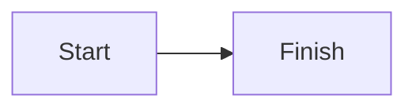

# Research brief

The brief opens with a paragraph that stays content.

## Goals

| Goal    | Owner |
| ------- | ----- |
| Sign in | Ada   |

- [x] Interview five people
- [ ] Share the notes

~~Old plan~~ replaced. See https://example.com for the method.[^1]

[^1]: The method.

Use <placeholder> in a sentence.

<script>window.studioHtmlRan = true</script>

<!-- a note for whoever edits this file -->

```ts
const greeting: string = 'hello'
```



## Screens


See  inline.

### Links

Read [the notes](./more/Notes), go [home](/), jump to [the details](#details) or visit [the method](https://example.com/method).

## Details

A long section so the page scrolls.

Line one.

Line two.

Line three.

Line four.

Line five.

Line six.

Line seven.

Line eight.

Line nine.

Line ten.

Line eleven.

Line twelve.

Line thirteen.

Line fourteen.

Line fifteen.

Line sixteen.

Line seventeen.

Line eighteen.

Line nineteen.

Line twenty.

## Last section

The end.
