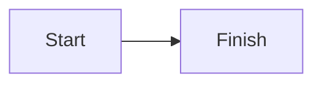

# Research brief

The brief opens with a paragraph that stays content.

## Goals

| Goal    | Owner |
| ------- | ----- |
| Sign in | Ada   |

- [x] Interview five people
- [ ] Share the notes

~~Old plan~~ replaced. Use <placeholder> in a sentence.

```ts
const greeting: string = 'hello'
```



## Screens


Read [the notes](./more/Notes.md).
